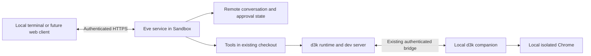

# Eve with a local client and remote execution

Eve runs beside the project in the sandbox, with its terminal UI running locally.
New CLI sandbox sessions launch it by default; `--harness eve` also selects it
explicitly. It does **not** implement persistent cross-launch conversations or
change d3k's compute cleanup. The standalone launcher connects to an already running sandbox.

The viable design is a local client using Eve's HTTP API, with an Eve service
running beside the existing checkout and dev server. Mosh/UDP is unnecessary:
editing input and reading the clipboard happen locally; submitted messages,
attachments, approvals, and resumable output cross the network.



Closing the laptop disconnects the client and browser companion. The remote
agent can keep editing and running commands. Browser work waits until a supported
companion reconnects. A user can answer a pending approval from another client
without creating a new conversation or repeating the original prompt.

## Try the local terminal

With the local canary installed, start a new sandbox through the CLI:

```sh
d3k --project my-team/my-project
# Explicit equivalent:
d3k --project my-team/my-project --harness eve
```

This creates a fresh checkout of the linked remote repository; it does not upload
uncommitted files from your current local directory. Existing saved sessions keep
their selected harness. Use `--harness fx`, `--harness codex`, or `--harness claude`
to select another harness, or `--no-shell` for a retained companion without one.

Keep a d3k sandbox session running with its local browser connected. In a local
interactive terminal, from this checkout, run:

```sh
bun scripts/eve/launch.mjs --resume <d3k-saved-session-id>
```

The launcher uses your local Vercel login, uploads this source into a separate
temporary service directory in that existing sandbox, installs pinned Eve
dependencies, and opens the local client. No commit, release, global Eve install,
or website deployment is needed. Management credentials remain on the laptop.
Each Eve session has a $1 maximum model budget and expires within 30 minutes or before
the current sandbox expires. Credentials stay in process memory and are not
printed or saved in a launcher file. The remote supervisor also stops Eve at
the access expiration even if the launcher disappears.
At expiry, the local composer or reconnect menu closes and the launcher explains
that the session time limit was reached. It does not renew access or replay a
message. Launch d3k again for a new Eve conversation.

Try these interactions:

1. Ask “Inspect the current browser and tell me its main heading.” Ordinary
   sandbox tools run without per-command approval. Tools with their own explicit
   approval policy still use Eve's keyboard panel; press **y** or **n**.
2. Paste a local image path normally, including CleanShot's shell-escaped paths.
   It becomes `[Image #1]` in the composer and its bytes upload with your message.
   For a binary clipboard image, press **Ctrl+V**. Neither requires `/paste`.
   Existing draft text stays in place. Cmd+V behavior depends on the terminal app;
   a terminal must emit an image file path, otherwise use Ctrl+V.
3. Ask “Run `sleep 20; echo finished` once.” Enter `/detach`,
   wait, then press Enter at the reconnect menu. It resumes the same conversation
   without submitting the prompt again.
4. Enter `/detach`, then press **Ctrl-C** at the reconnect prompt to exit and remove its model
   key and service route. The existing d3k app and browser remain running.

Interactive terminals use Eve's actual composer, transcript renderer, and approval
panels from pinned Eve 1.0.0-rc.6 internals. A d3k adapter supplies a fixed remote
session and local image uploads. This is not the full Eve CLI runner: its other
setup commands are unavailable; model switching uses Eve’s dynamic model API. Image attachments use numbered markers,
not inline pixel previews. Noninteractive IO retains the plain client fallback.
Native internal imports must be revalidated before upgrading Eve.
The launcher appends the shared connected-session d3k skill to Eve's instructions,
including the actual remote checkout and app URL. Its tools run in the sandbox;
the native terminal UI runs locally. UI edits should be checked against the
already-running dev server through the paired browser before reporting completion.
Temporary Bun installs exempt only `eve` from an inherited minimum-release-age
delay so the pinned RC can be installed immediately; global configuration stays unchanged.

For requested pushes and PRs, Eve can use the remote runtime's `github` command
through the paired companion. It reaches the same linked-repository Git Data/PR
APIs as desktop `sandbox_github`, using the laptop's existing `gh` authentication.
No GitHub credential enters the sandbox. This fallback requires the companion
to remain connected; it does not provision managed Git credentials in the VM.

Keep the Eve launcher and d3k open while trying it. Exiting the launcher normally
stops its Eve service; a later invocation starts a fresh Eve conversation. This
launcher does not implement phone handoff or d3k's eventual laptop-close lifecycle.

For a noninteractive live setup/model/cleanup check, add `--check`:

```sh
bun scripts/eve/launch.mjs --resume <d3k-saved-session-id> --check
```

## Model

New sessions default to **Claude Haiku 5.5 with thinking off**. In a terminal,
`/model` opens the native picker. `/model haiku`, `/model mini`, `/model flash`,
and `/model sonnet` switch directly; `/model current` reports the selection.
The choices are Haiku 5.5, GPT 5.4 Mini, Gemini 3.8 Flash, and Sonnet 4.6.
All support image input and tool use according to AI Gateway's model catalogue.

The local selection travels as authenticated request metadata. Eve's dynamic
model callback selects it for subsequent model calls without clearing the
conversation or asking the model to interpret a slash command. Detaching and
reconnecting within the same launcher preserves the choice. `settings.mjs`
contains the validated choices and reasoning levels; the UI does not control
Gateway budgets, credentials, or approvals.

## Run the verification

From the repository root, with Node 24+ and Bun:

```sh
node scripts/eve/verify.mjs
```

The verifier installs pinned `eve@1.0.0-rc.6`, `ai@7.0.159`, and `zod@4.6.7` in
a temporary directory. It builds and starts a real Eve service with a deterministic
test model. It uses no model credentials, Chrome, Portless, or Vercel resources,
and removes the service and temporary checkout afterward.

To reuse an existing installation of those versions:

```sh
D3K_EVE_PACKAGE_ROOT=/absolute/path/to/node_modules/eve node scripts/eve/verify.mjs
```

The verification checks:

- Unauthenticated creation, continuation, and conversation reads return 401.
- A client process exits during a shell command; the command finishes in the
  existing checkout while no client is observing it.
- A new client replays that conversation, with exactly one original prompt.
- A new client recovers a pending approval; answering runs the waiting tool once.
- A local PNG reaches the model as inline image content.
- The local terminal client reattaches, uploads an image, and detaches without
  creating another conversation.
- Cancellation terminates the command process group, including a TERM-resistant
  child.

These are integration checks of Eve's actual service, provider, and public SDK.
The deterministic model does not establish coding quality or real-provider vision
quality. This deterministic verifier does not exercise macOS clipboard reading,
live Vercel routing, browser re-pairing, or a phone UI.

## Live Sandbox validation — November 5, 2026

The uncommitted scaffold was uploaded directly into a separate service directory
in a fresh Vercel Sandbox for `vercel-labs/dev3000-www`. No main push, npm release,
or website deployment was needed. Eve ran beside the existing checkout and dev
server, using a project-scoped Gateway key with a $1 non-renewing limit and a
20-minute expiration. The real model was `anthropic/claude-sonnet-4.6`.

The following live checks passed:

- Eve served HTTPS through an additional Sandbox route. Unauthenticated session
  creation, history streaming, and continuation each returned 401.
- A separate local client recovered a pending approval, approved one exact shell
  command, and exited. With no client observing that conversation, the command
  slept for 20 seconds and appended one marker to a temporary file. Reconnecting
  recovered the same conversation, one original user prompt, one tool call, and
  the completed assistant reply. The marker appeared exactly once. The second
  admitted delivery was the approval answer, not a repeated prompt.
- A synthetic 64×64 red PNG generated on the laptop reached the remote vision
  model, which answered “Red”. The actual terminal client's `/attach` flow also
  uploaded it, received “red”, and exited successfully with `/detach`.
- Eve's approved shell tool invoked the existing d3k runtime's `status` and
  `browser snapshot -i`. It reached the paired local Chrome and correctly reported
  the page heading: “Your coding agent should see what your app is doing.”

An initial d3k launch failed because the test's custom Next command hardcoded
port 3000, colliding with d3k's sandbox proxy. Resuming the same sandbox with a
command that honors the supplied `PORT` restored the app and local browser:

```sh
--command 'bun x next dev --hostname 0.0.0.0 --port "$PORT"'
```

After validation, the test Eve service was stopped, its public route removed,
and its Gateway key removed. The d3k app and local Chrome connection were left
running. The installed local Vercel CLI used `ai-gateway api-keys remove`; it did
not support the `revoke` spelling.

This validates client process exit/reconnect, real-provider image delivery, and
remote Eve controlling local Chrome. It does **not** validate actual laptop sleep,
network loss during a tool call, browser bridge re-pairing while Eve is active,
another physical device, clipboard `/paste`, or a phone UI. Normal d3k stop still
stops owned compute. The detach/resume integration below remains required before
advertising laptop-close background execution as a product feature. The rc.2
server restart limitation below remains unresolved.

## Important finding: server restart recovery

Client disconnection and Eve server replacement are different operations.
Client reconnect and approval recovery pass while the Eve service stays alive.
Repeated tests of **restarting the Eve service itself immediately after a tool
approval pauses** are unreliable in this configuration on rc.2: the new service
can replay the approval and accept its answer, but execution sometimes does not
continue within 60 seconds. One run succeeded; several did not. The cause has
not been isolated to Eve, its local Workflow world, or shutdown timing.

The optional reproducer exercises this additional case and may fail:

```sh
D3K_EVE_TEST_RESTART=1 D3K_EVE_KEEP_FIXTURE=1 node scripts/eve/verify.mjs
```

Do not describe arbitrary process restart recovery as proven. Laptop sleep does
not require restarting Eve. The first integrated mode should retain the same
remote process on detach and reconnect. Also pin Eve for the lifetime of each
conversation: its documentation says changing Eve versions strands existing
self-hosted sessions.

## Components

- `agent/` is a real-agent scaffold. It uses Eve's default shell/file tools,
  runs ordinary tools without per-command approval and supplies d3k browser instructions.
- `connection.mjs` implements Eve's custom sandbox connection over an existing
  host filesystem and process tree. It is **not** a security sandbox. It belongs
  inside the Vercel Sandbox that already isolates execution. Ending a conversation
  never deletes the checkout or stops the shared dev server.
- `client.mjs` is a small local terminal using public `eve/client` APIs. It can
  attach to a fixed session ID, replay history, answer pending interactions, queue
  images, cancel a turn, and detach. It writes no local conversation history.
- `fixture-agent.ts` replaces the real model only inside the verifier's temporary
  service. It is not part of a real-agent deployment.

The custom provider deliberately rejects authored sandbox seed files rather than
copying them over an existing checkout. Adding Eve's code extension requires
handling its skill/template setup before mounting it; this integration uses the default
tools. All conversations intentionally share this one project checkout, so edits
from simultaneous sessions are not isolated from each other.

## Run against a prepared service

Place `agent/`, `settings.mjs`, and `connection.mjs` together in a service directory **inside the
already isolated remote VM**, separate from the project checkout. Install the
pinned dependencies above there with Bun. Configure the following server env:

| Variable                  | Purpose                                                                                 |
| ------------------------- | --------------------------------------------------------------------------------------- |
| `D3K_EVE_WORKDIR`         | Absolute existing project checkout                                                      |
| `D3K_EVE_ISOLATED_HOST=1` | Explicit acknowledgement that the host is already isolated; this flag adds no isolation |
| `D3K_EVE_TOKEN`           | Random per-sandbox bearer token, at least 32 characters                                 |
| `D3K_EVE_EXPIRES_AT`      | Token expiration as a Unix timestamp in milliseconds                                    |
| `AI_GATEWAY_API_KEY`      | Project-scoped, expiring, budget-limited Gateway key                                    |

Build with `node node_modules/eve/bin/eve.js build`, then supervise
`node node_modules/eve/bin/eve.js start --host 0.0.0.0 --port 3001 --no-schedules`.
Expose it through authenticated HTTPS. Forward `/eve/` and
`/.well-known/workflow/` without rewriting their paths. Preserve the service's
`.eve/.workflow-data` on the sandbox disk. Do not send Vercel management tokens
or laptop harness credentials to the service.

The **local** client needs an existing Eve installation. Set
`D3K_EVE_PACKAGE_ROOT` to that package directory, `D3K_EVE_URL` to the HTTPS service
origin, and `D3K_EVE_TOKEN` through the environment; then run:

```sh
node scripts/eve/client.mjs
node scripts/eve/client.mjs --session <printed-session-id>
```

`/attach /absolute/path.png` queues a local image. On macOS, **Ctrl+V** reads and
attaches a PNG from the local clipboard; `/paste` remains a command alternative.
Neither captures a screenshot. Send a
message to upload the queued image. `/answer <interaction-id> <option-id or text>`
answers a pending request. `/cancel` cancels execution; `/detach` or Ctrl+C leaves
it running remotely. Interactive terminals use Eve’s native renderer.

## Required d3k integration before shipping

1. The CLI Eve mode uses remote agent execution and a local client.
   Eve rc.2's standard `remote connect` TUI creates a fresh session and has no
   existing-session option; use the public SessionStore path demonstrated here,
   or add resume support upstream. Do not silently start a new conversation.
2. Introduce detach separately from stop. Today's `closeSandboxResources()` stops
   owned compute and removes harness credentials. That would defeat this design.
   Keep the remote Eve service and scoped Gateway key until their bounded expiry;
   an explicit stop should still release them.
3. Resume by reconnecting to the retained service and fixed conversation first.
   Today's sandbox resume reinstalls tools/dependencies and restarts the dev
   runtime. Re-pair only the browser bridge and local proxy where possible;
   do not interrupt an active Eve command to resume the client.
4. Extend discovery metadata with Eve version and conversation identity, keeping
   secrets and transcript history remote. Retrieve a new device's access through
   owner-authenticated control, rather than putting bearer credentials in URLs.
5. Prove those lifecycle changes in a real Vercel Sandbox, including laptop network
   loss, Gateway expiry, explicit stop, and browser calls while disconnected.
   Resolve the optional restart reproducer before claiming crash recovery.

A phone can use the same Eve API through a future web client. This terminal
client does not provide a phone UI. The macOS d3k companion cannot automatically turn
iPhone Safari into an automated Chrome/CDP endpoint. Another supported desktop
can attach its own companion and browser profile; transferring authenticated
Chrome profiles to the remote sandbox is a separate problem and is not required
for continued coding.

Sandbox timeout and Gateway expiry bound background work. Persisted history on a
sandbox filesystem is not a promise of unlimited compute or permanent storage.

## Browser and security implications

This approach needs no public raw CDP endpoint and no UDP ingress. Retain d3k's
authenticated bridge, isolated browser profile, and scoped Gateway credentials.
The Eve API grants project command execution: use a distinct expiring token for
each sandbox, HTTPS, and owner authorization when obtaining it on another device.
The service strips service credentials from shell-command environments, but
the agent and service share the VM/Unix identity; that is not a credential
isolation boundary.

The laptop companion uses the installed standard Google Chrome executable with
its existing per-project automation profile. The macOS confinement policy still
blocks unrelated files, system clipboard access, and the normal keychain.
Chrome updates remain managed by the user's installation or IT. The everyday
browser profile is separate and is not exposed to remote automation.

References: [Eve self-hosting](https://eve.dev/docs/guides/deployment/self-hosting),
[custom providers](https://eve.dev/docs/sandbox/custom-providers),
[sessions and streaming](https://eve.dev/docs/concepts/sessions-runs-and-streaming),
[terminal UI](https://eve.dev/docs/guides/dev-tui),
[self-hosted operations](https://eve.dev/docs/guides/deployment/self-hosted-operations),
and [Mosh](https://mosh.org).
